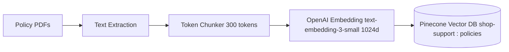
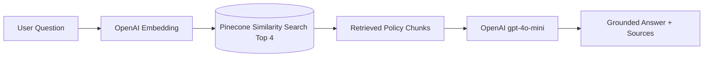

# ShopSphere — GenAI RAG Application

An end-to-end, production-ready **Retrieval-Augmented Generation (RAG)** customer support application built purely in **JavaScript (Node.js & Express)**.

This project showcases key Generative AI and RAG architecture principles:
- **Document Parsing & Text Extraction** from official policy PDFs
- **Token-based Chunking** using `js-tiktoken` (tokenizer: `cl100k_base`)
- **Dense Vector Embeddings** via OpenAI's `text-embedding-3-small` (1024 dimensions)
- **Vector Database Storage & Nearest-Neighbor Search** via **Pinecone**
- **Strict Grounded Generation** via OpenAI LLM (`gpt-4o-mini`) guardrailed against hallucinations
- **Full Web Application** with an interactive chat interface and robust REST API endpoints

---

## Project Architecture

The project is structured into modular layers:

```
ShopSphere-GenAI-RAG-Support/
├── knowledge/                     # Self-contained official policy PDFs
│   ├── exchange-policy.pdf
│   ├── orders-account-help.pdf
│   ├── payment-refund-policy.pdf
│   ├── return-policy.pdf
│   └── shipping-delivery.pdf
│
├── public/                        # Modern Web Application Frontend
│   ├── index.html                 # ShopSphere Support UI
│   ├── style.css                  # Dark mode, glassmorphism, responsive styles
│   └── app.js                     # Real-time chat, source badges, indexing UI
│
├── src/
│   ├── config/
│   │   └── env.js                 # Centralized configuration & .env validation
│   ├── services/
│   │   ├── pdfService.js          # PDF extraction (unpdf) & token chunking (js-tiktoken)
│   │   ├── openaiService.js       # Embeddings & chat completions (OpenAI SDK)
│   │   ├── pineconeService.js     # Vector database upsert & similarity search
│   │   └── ragService.js          # Ingestion pipeline & context-grounded Q&A
│   ├── controllers/
│   │   └── chatbotController.js   # Handlers for /query, /ingest, and /status
│   ├── routes/
│   │   └── apiRoutes.js           # Express API router
│   ├── cli.js                     # Command-line interface for terminal testing
│   └── server.js                  # Express web server
│
├── .env.example                   # Configuration template
├── .env                           # Active environment keys
├── index.js                       # Primary entry point & module re-exports
└── package.json                   # Dependencies and npm scripts
```

---

## Core Concepts & RAG Architecture

### 1. What is RAG?
Large Language Models (LLMs) do not know your internal company documents by default. Instead of fine-tuning the model, **Retrieval-Augmented Generation (RAG)**:
1. Retrieves the most relevant company policy excerpts from a vector database.
2. Injects those excerpts into the system prompt as grounding context.
3. Asks the LLM to answer using **ONLY** the provided context.

### 2. The Ingestion Pipeline (`npm run ingest`)

- Each PDF is converted to plain text.
- Text is split into chunks of ~300 tokens to ensure semantic coherence.
- Each chunk is hashed with SHA-256 to ensure idempotent, duplicate-free upserts.
- OpenAI generates a 1024-dimension vector for each chunk and stores it in Pinecone.

### 3. The Query Pipeline (`GET /api/v1/query?question=...`)

- The user's question is embedded into the same 1024-dimensional space.
- Pinecone finds the top 4 closest semantic matches.
- The system synthesizes an accurate answer strictly based on those matches.

---

## Setup Instructions

### 1. Prerequisites
- **Node.js**: v18 or higher (tested on Node v24)
- **OpenAI API Key**: [Get key here](https://platform.openai.com/api-keys)
- **Pinecone API Key**: [Get key here](https://app.pinecone.io/)

### 2. Install Dependencies
Open your terminal in the project root directory and run:

```bash
npm install
```

*(Note for Windows users: if PowerShell gives an execution policy error on `npm`, run `npm.cmd install`)*

### 3. Configure Your Environment (`.env`)
Copy `.env.example` to `.env` in the project root and add your keys:

```bash
cp .env.example .env
```

```env
# OpenAI Configuration
OPENAI_API_KEY=sk-your-openai-api-key-here
CHAT_MODEL=gpt-4o-mini
EMBEDDING_MODEL=text-embedding-3-small
EMBEDDING_DIMENSIONS=1024

# Pinecone Configuration
PINECONE_API_KEY=your-pinecone-api-key-here
PINECONE_INDEX_NAME=shop-support
PINECONE_NAMESPACE=policies

# RAG Configuration
CHUNK_SIZE=300
TOP_K=4

# Server Port
PORT=3000
```

> **Pinecone Setup Note:** In the Pinecone web console, create an index named **`shop-support`** with dimensions **`1024`** and metric **`cosine`**.

---

## Quick Start & Usage

### 1. Run the Web Application
```bash
npm start
```
Then open your browser at:
**[http://localhost:3000](http://localhost:3000)**

You will see the **ShopSphere Customer Support Intelligence** UI:
- Click **"Index Knowledge Base"** to automatically ingest the PDFs into Pinecone.
- Click any quick question chips or type any question to test RAG retrieval.
- View the exact source documents referenced below each answer.

### 2. Run Ingestion via CLI
You can also index your knowledge base straight from your terminal:
```bash
npm run ingest
```

### 3. Query via CLI
Ask a question directly in your terminal:
```bash
npm run query -- "What is the return policy?"
```
Or simply:
```bash
node index.js "Can I exchange for a different size?"
```

---

## REST API Endpoints

The server exposes standard REST API endpoints for web, mobile, or external client integrations:

| Method | Endpoint | Query / Body | Description |
|---|---|---|---|
| `GET` | `/api/v1/query?question=...` | Query param: `question` | URL query parameter endpoint |
| `POST` | `/api/v1/query` | JSON: `{ "question": "..." }` | Standard REST query endpoint |
| `POST` | `/api/v1/ingest` | None | Triggers PDF text extraction & vector upsert |
| `GET` | `/api/v1/status` | None | Returns configuration, models, and PDF counts |

### Example API Response
```json
{
  "answer": "Most products may be returned within 30 calendar days from delivery. The item must be unused, undamaged, and returned with its original packaging, accessories, and tags.",
  "sources": ["return-policy.pdf"],
  "matches": [
    {
      "id": "a9b8...",
      "score": 0.884,
      "source": "return-policy.pdf",
      "chunk": 0
    }
  ]
}
```

---

## Windows PowerShell Configuration

If running on Windows PowerShell:
- **Scripts Disabled Error**: Run commands with `npm.cmd` (e.g. `npm.cmd start`) or enable script execution in PowerShell:
  ```powershell
  Set-ExecutionPolicy -Scope CurrentUser -ExecutionPolicy RemoteSigned
  ```
- **Environment variables**: You don't need to manually type `$env:OPENAI_API_KEY="..."`. The application automatically loads everything from your `.env` file!
